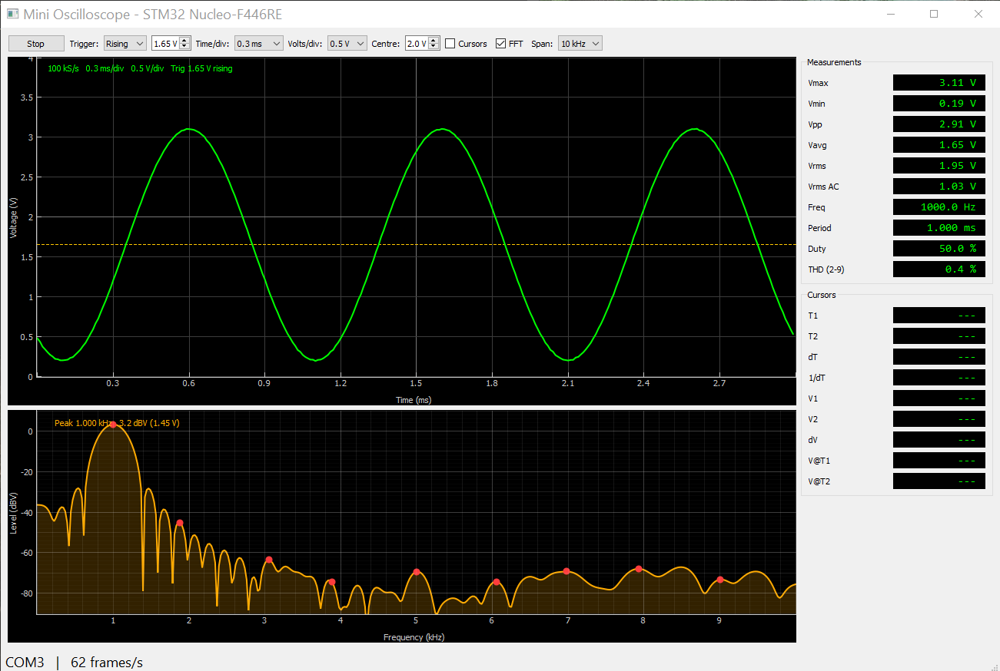
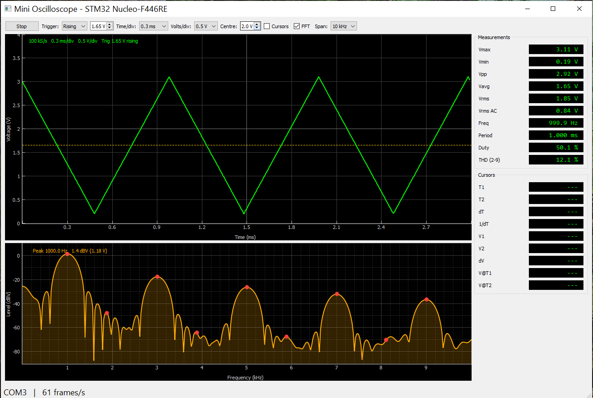
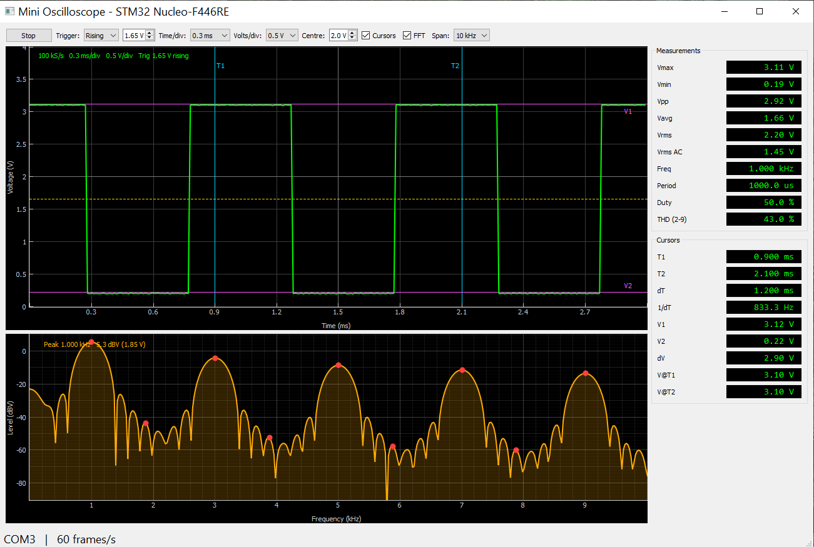
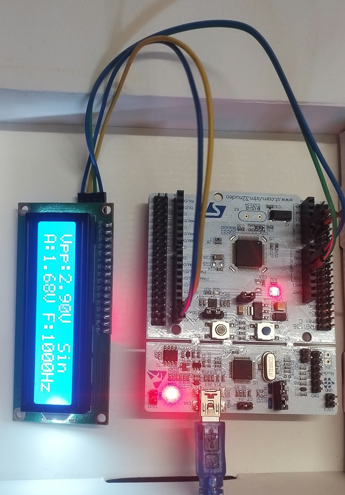
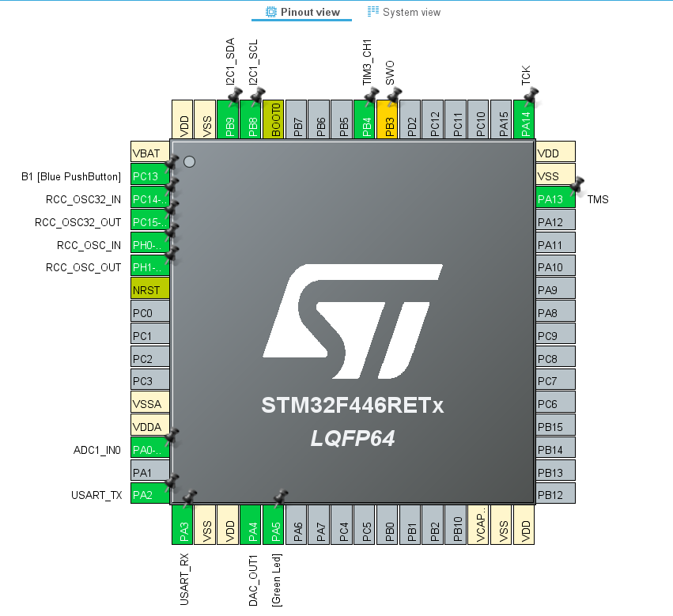
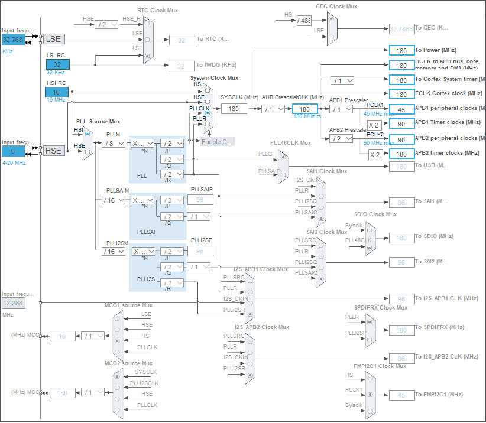

# Mini Oscilloscope on STM32 Nucleo-F446RE

A 100 kS/s mini oscilloscope with a built-in function generator, built on the STM32 Nucleo-F446RE. A 16x2 LCD shows live measurements, and a Python (PyQtGraph) app on the PC gives a full scope screen with trigger, cursors, measurements and an FFT spectrum.

## Demo
The PC scope showing the three built-in test waves (1 kHz):

**Sine**



**Triangle**



**Square**





## Features
**Firmware (STM32)**
- 12-bit ADC sampling at an exact 100 kS/s (timer-triggered, DMA, no CPU load)
- Sine, triangle and square test waves (1 kHz) from the on-chip DAC, switched with the blue USER button
- 16x2 I2C LCD: Vpp, average voltage, frequency and the active wave type
- Framed data stream to the PC over UART at 921600 baud

**PC app (Python, PyQtGraph)**
- Scope screen with a 10 x 8 graticule, Run/Stop, rising or falling trigger with draggable level
- Adjustable time/div, volts/div and centre
- Measurements: Vmax, Vmin, Vpp, Vavg, Vrms, AC Vrms, frequency, period, duty cycle, THD
- Draggable time and voltage cursors (dT, 1/dT, dV, V@T)
- FFT spectrum (Hann window, selectable span) with harmonic markers

## Hardware
- STM32 Nucleo-F446RE
- 16x2 HD44780 LCD with I2C backpack (address 0x27 or 0x3F, auto-detected)
- Jumper wires and a USB cable

## Wiring
| Signal | Pin | Connected to |
|---|---|---|
| ADC input | PA0 (A0) | measured signal (0 to 3.3 V only) |
| DAC output | PA4 (A2) | A0 (built-in test signal) |
| LCD SCL / SDA | PB8 (D15) / PB9 (D14) | LCD backpack |
| LCD VCC / GND | 5V / GND | LCD backpack |
| Optional PWM test | PB4 (D5) | 1 kHz square wave |
| Wave select | PC13 (USER button) | built in |
| UART to PC | PA2 / PA3 | ST-LINK virtual COM port |



## How it works
```
 signal --> PA0 --> ADC1 <-- TIM2 (100 kHz trigger)
                      |
                    DMA (circular, 512 samples)
                      |
                frame buffer --> USART2 (921600 baud) --> PC: scope_pro.py
                      |
        Vpp / average / frequency --> I2C LCD

 wave table (100 pts) --> DMA --> DAC (PA4) <-- TIM6 (100 kHz) --> 1 kHz wave
        ^
        USER button cycles sine / triangle / square
```
**Frame format:** header `0xAA 0x55`, then 512 samples as little-endian uint16.

## CubeMX configuration
| Peripheral | Settings |
|---|---|
| Clock | HCLK 180 MHz |
| ADC1 | IN0, 12-bit, external trigger TIM2 TRGO (rising), DMA circular, half-word |
| TIM2 | prescaler 89, period 9, TRGO = update (100 kHz) |
| DAC | OUT1, TIM6 trigger, output buffer on, DMA circular, half-word |
| TIM6 | prescaler 0, period 899, TRGO = update (100 kHz) |
| TIM3 | CH1 PWM, prescaler 89, period 999, pulse 500 (1 kHz) |
| USART2 | 921600, 8N1 |
| I2C1 | 100 kHz, PB8 / PB9 |



## Getting started
1. **Firmware:** open `firmware/mini_scope/` in STM32CubeIDE (File > Import > Existing Projects), build, and flash to the board.
2. **Wiring:** connect A2 to A0 for the built-in test signal, and wire the LCD as in the table above.
3. **PC app:**
   ```
   pip install -r pc_setup/requirements.txt
   ```
   Open `pc_setup/scope_pro.py` and set `PORT` to your ST-LINK COM port (Windows: Device Manager > Ports). Close any serial terminal, then run:
   ```
   python pc_setup/scope_pro.py
   ```
4. Press the blue USER button to cycle sine, triangle and square waves.

## Results
- 1 kHz test waves are steady on the screen with the trigger at 1.65 V
- Measured Vpp about 2.90 V (DAC waves), average 1.65 V, frequency 1000 Hz
- Square wave THD about 43 % and triangle about 12 % over harmonics 2 to 9, matching theory

## Limits
- Input range is 0 to 3.3 V only. Negative or higher voltages can damage the board.
- Fixed 100 kS/s sample rate and a 512-sample record (5.12 ms), so usable signals are up to about 10 kHz.
- The FFT frequency resolution is about 200 Hz because of the short record.

## Possible upgrades
- Adjustable amplitude, frequency and sample rate from the PC
- Real sensor inputs with input protection
- OLED display for a standalone version

## What I learned
Timer-triggered ADC with DMA, DAC waveform generation, UART framing, I2C display driving, and building a real-time GUI with FFT analysis in Python.

## License
MIT
